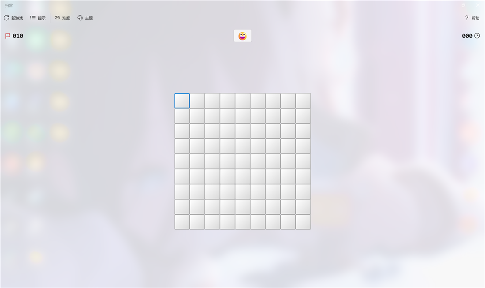
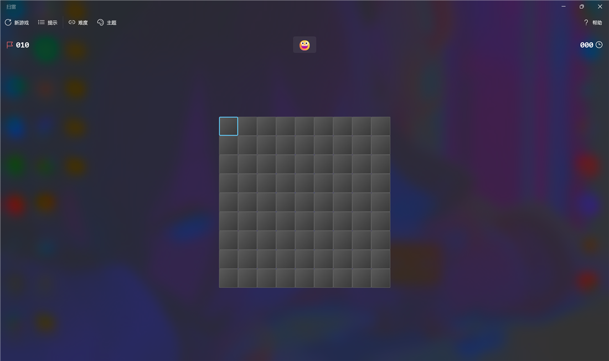
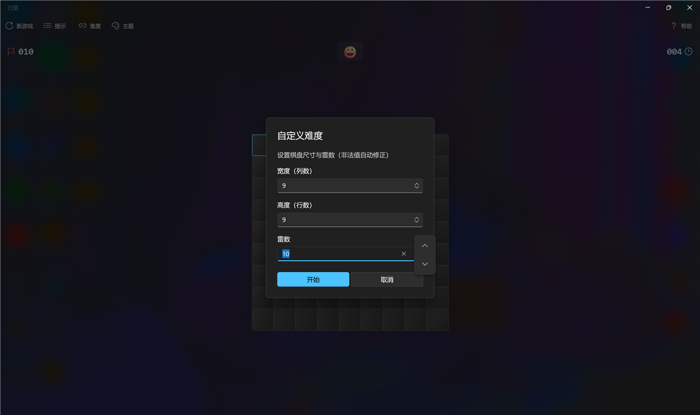
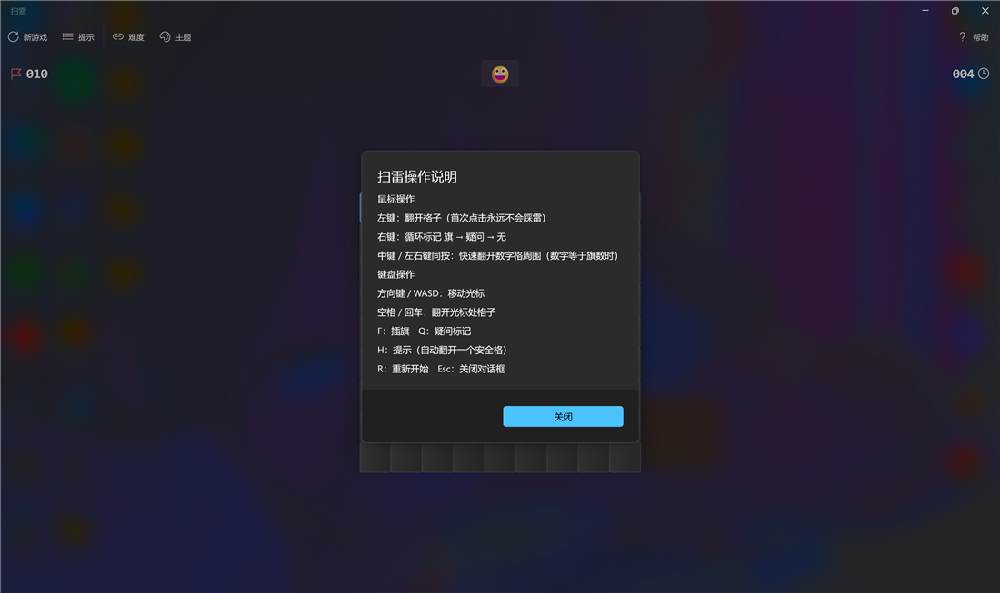

# 💣 扫雷 Minesweeper

一款 **Windows 11 原生扫雷游戏**，基于 **WinUI 3 / Windows App SDK** 构建，完整遵循 Windows 11 设计语言（Fluent Design、Mica/亚克力材质）。

    

## 📸 截图

| 浅色主题 | 深色主题 |
|---------|--------|
|  |  |

| 自定义难度 | 快捷键位 |
|---------|-----------|
|  |  |

## ✨ 功能特性

- 🖱️ **完整鼠标操作**：左键翻开、右键循环标记（旗 → 疑问 → 无）、中键 / 左右键同按快速翻开（chord）
- ⌨️ **完整键盘操作**：方向键 / WASD 移动光标、空格 / 回车翻开、F 插旗、Q 疑问、H 提示、R 重开
- 🎹 **键位自定义**：帮助菜单「键位设置…」可自由更换全部按键（每个动作支持双键位，支持 Ctrl/Alt/Shift 组合键，冲突自动拦截）
- ↩️ **撤销**：工具栏按钮或 `Ctrl+Z` 回退上一步操作，最多 50 步，踩雷后也能后悔
- 🎚️ **三种预设难度 + 自定义**：初级 9×9·10 雷 / 中级 16×16·40 雷 / 高级 30×16·99 雷，自定义宽高（3~40）与雷数（自动校验）
- 💡 **智能提示系统**：自动找出安全格并翻开（优先选择有信息量的格子）
- 🌓 **主题切换**：浅色 / 深色 / 跟随系统
- 🪟 **Windows 11 原生外观**：Mica/亚克力毛玻璃背景、圆角菜单与对话框、Fluent 图标、自绘应用图标
- 🎯 **经典规则**：首击永不踩雷、0 格洪水展开、数字快速翻开（chord）、计时器、剩余雷数计数
- ♿ **无障碍**：每格带自动化名称，键盘可完全操作

## 🎮 操作指南

| 操作 | 鼠标 | 键盘 |
|------|------|------|
| 翻开格子 | 左键 | 空格 / 回车 |
| 标记（旗→疑问→无） | 右键循环 | F（旗）/ Q（疑问） |
| 快速翻开周围 | 中键 / 左右键同按 | 光标移到数字格后回车 |
| 提示 | 工具栏"提示"按钮 | H |
| 新游戏 | 工具栏"新游戏" | R |
| 撤销 | 工具栏"撤销" | Ctrl+Z |
| 移动光标 | 点击 | 方向键 / WASD |

## 🚀 快速开始

### 方式一：绿色免安装版（推荐）

下载 `MinesweeperPortable.zip`，解压后**直接双击 `Minesweeper.exe`** 即可运行。
无需安装、无需证书，Windows 10 1809+ / Windows 11 均可。

### 方式二：MSIX 一键安装

下载 `MinesweeperSetup.zip`，解压后双击 `一键安装.cmd`（自动安装签名证书与应用包），完成后从开始菜单启动"扫雷"。

## 🔧 从源码构建

**环境要求**：Windows 11（或 10 1809+）、.NET SDK 8.0、Visual Studio 2022 Build Tools（或 VS 2022）

```bash
# 还原依赖
dotnet restore src/Minesweeper/Minesweeper.csproj

# 运行单元测试（55+ 用例）
dotnet test tests/Minesweeper.Core.Tests

# 构建 MSIX 安装包
MSBuild src/Minesweeper/Minesweeper.csproj /p:Configuration=Release /p:Platform=x64

# 构建绿色免安装版
MSBuild src/Minesweeper/Minesweeper.csproj /p:Configuration=Release /p:Platform=x64 ^
    /p:WindowsPackageType=None /p:WindowsAppSDKSelfContained=true /p:GenerateAppxPackageOnBuild=false
```

> MSIX 打包需要签名证书，首次构建请运行 `scripts/make-cert.ps1` 生成开发证书。
> 本机无 VS 环境的构建细节见 [CONTINUE.md](CONTINUE.md)。

## 📁 项目结构

```
├── src/
│   ├── Minesweeper/              # WinUI 3 主项目
│   │   ├── Core/                 # 游戏核心逻辑（纯 C#，零 UI 依赖）
│   │   ├── Controls/             # 棋盘控件（渲染与交互）
│   │   └── Themes/               # 主题资源
│   ├── Minesweeper.Core/         # 核心逻辑类库
│   └── ...
├── tests/Minesweeper.Core.Tests/ # 单元测试（xunit）
├── scripts/                      # 构建/打包/证书/图标脚本
└── docs/                         # 文档与截图
```

## 📝 许可证

[LICENSE](LICENSE)：**MIT License + 附加条款**

**附加条款**：
1. **商业使用必须开源**：任何商业用途（销售、集成到商业产品或服务等）须将修改后的与本软件有关部分的完整源码开源。
    **Mandatory Open-Sourcing for Commercial Use**：All commercial use (sales, integration into commercial products/services, etc.) requires full open-source disclosure of the complete source code for all project-related modifications.

2. **功能免费**：本软件及其所有相关功能不得在被引用的软件中就涉及本软件的部分向最终用户收费。
    **Free Functionality Requirement**： After referencing this software and its related functionalities, you may not charge end users for any parts related to this software.

## 🛠️ 技术栈

- [WinUI 3 / Windows App SDK 1.7](https://learn.microsoft.com/windows/apps/winui/winui3/)
- .NET 8
- xunit（单元测试）
- Mica / Acrylic 背景材质
- 单项目 MSIX 打包 / 自包含部署

---

⭐ 如果这个项目对你有帮助，欢迎 Star！有问题请提 [Issue](https://github.com/phcwpm2kaf28-boop/Minesweeper/issues)。
